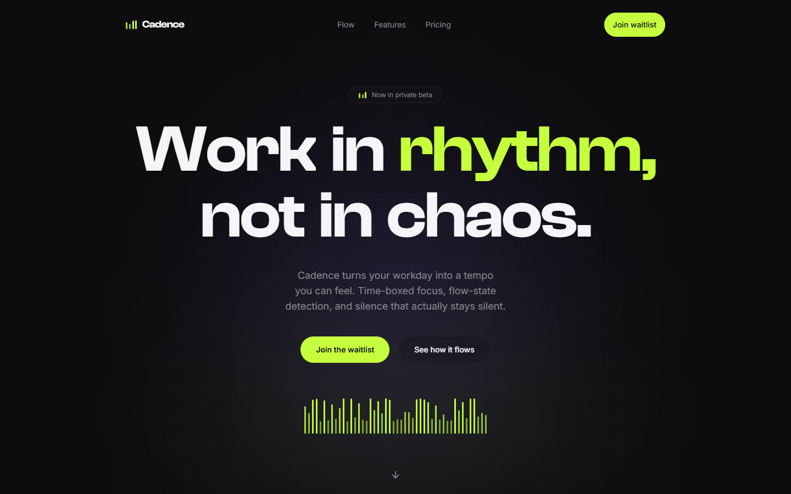
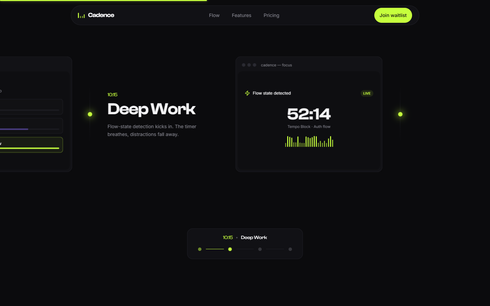
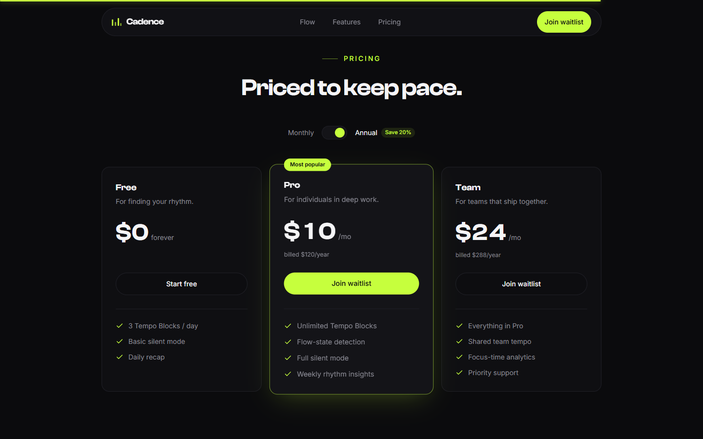
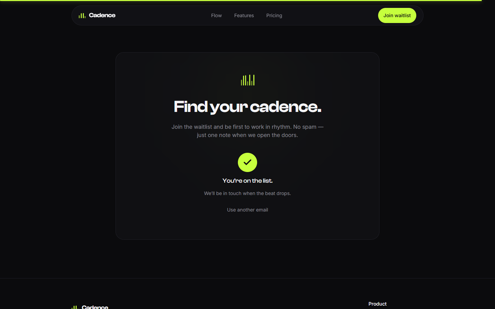
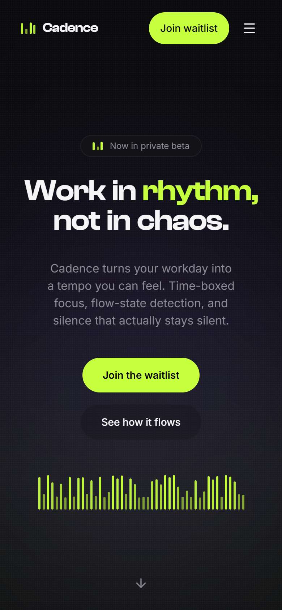
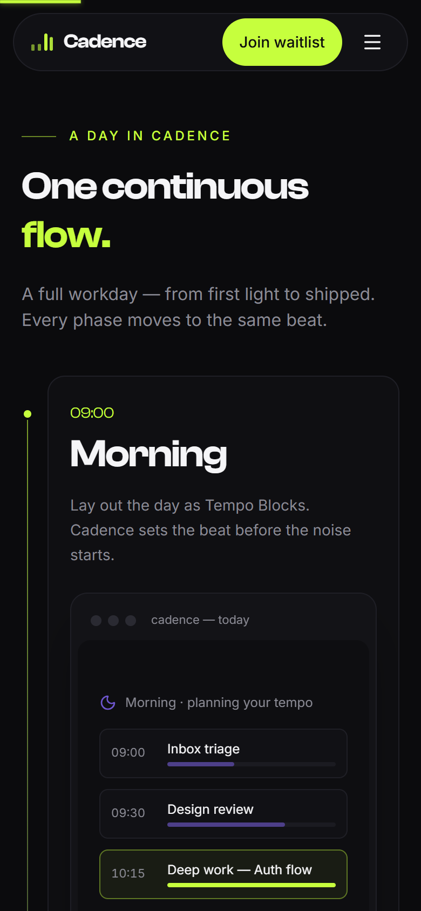

# Cadence: a focus-app landing page

[](https://github.com/menaka809/cadence/actions/workflows/ci.yml)

A motion-led SaaS landing page for a concept focus app. It has a scroll-driven GSAP timeline, Lenis smooth scrolling, and a working waitlist backed by Resend. Built with Next.js 16 and React 19.

**[Open the live site →](https://cadence-xi-three.vercel.app/)** The waitlist is real: joining stores your email in Resend and notifies the owner.



## Highlights

### Motion
- **Horizontal flow timeline.** One pinned GSAP ScrollTrigger turns vertical scroll into a sideways walk through a workday. Each phase reveals with a clip-path wipe driven by `containerAnimation`, and a live tracker shows the current phase. Its dots jump straight to any phase.
- **Lenis on GSAP's ticker.** Smooth scrolling and ScrollTrigger share one animation loop, so pinned sections never drift. In-page links scroll smoothly, move keyboard focus to the section, and land correctly even when arriving from another page (`/#pricing`).
- **Small touches:** a scroll-scrubbed word reveal, an odometer price roll on the billing toggle, magnetic buttons, tilt cards, and a progress line across the top.
- **CSS-first hero.** The headline's masked word rise is a CSS animation, so it plays from the server HTML without waiting for JavaScript.

### A waitlist that actually works
- **`POST /api/waitlist`** validates with a Zod schema shared by the form and the server, stores the contact in Resend and notifies the owner by email. A welcome email goes to the subscriber once a sending domain is verified.
- **Abuse protection:** a honeypot field, per-IP rate limiting with `Retry-After`, and a body-size cap.
- **Duplicate-aware:** signing up twice says "You're already on the list" and sends nothing.
- **Privacy by default:** email addresses are never logged or echoed in errors, and the form links to a plain-language [privacy page](https://cadence-xi-three.vercel.app/privacy).
- **Every state designed:** loading, joined, already joined, invalid email, rate-limited, server error and offline. Each state is announced to screen readers, and focus moves to the result.

### Quality
- **Accessibility:** WCAG AA contrast on every text colour, a skip link, visible focus rings, a keyboard-friendly mobile menu (Escape closes it, focus is managed), real buttons and switches, and 44px tap targets.
- **Reduced motion:** with the OS setting on, framer-motion skips transforms (`MotionConfig`), Lenis is off, and the flow timeline becomes a static stack with nothing pinned or scrubbed.
- **Performance:** a self-hosted display font with a size-matched fallback (no layout shift), no render-blocking third-party CSS, and zero CLS.
- **SEO and sharing:** title template, Open Graph and Twitter cards, a generated share image, icon, sitemap and robots.

## Screenshots

| Flow timeline | Pricing |
|---|---|
|  |  |
| **Waitlist success** | |
|  | |

<p>
  
  
</p>

## Tech stack

| Area | Tools |
|---|---|
| Framework | Next.js 16 (App Router), React 19, TypeScript |
| Styling | Tailwind CSS v4 |
| Motion | GSAP + ScrollTrigger, Lenis, Framer Motion |
| Forms | React Hook Form + Zod (one schema for client and server) |
| Email | Resend (contacts + transactional email) |
| Tooling | ESLint, GitHub Actions CI (typecheck, lint, build), Vercel |

## Project structure

```
app/
  api/waitlist/        Waitlist endpoint (validation, honeypot, rate limit, Resend)
  privacy/             Privacy page
  opengraph-image.tsx  Generated share card
components/
  FlowTimeline.tsx     Pinned horizontal timeline (stacked on phones / reduced motion)
  SmoothScroll.tsx     Lenis + ScrollTrigger in one loop, section links, hash landing
  WaitlistCTA.tsx      Form and all of its states
  flow/                The UI mockups shown in each phase
lib/
  waitlist.ts          Shared Zod schema and response types
  site.ts              Site name, URLs and metadata
scripts/
  fetch-fonts.mjs      Downloads the heading font before each build
```

## Run locally

Requires Node.js 22+.

```bash
npm ci
cp .env.example .env.local   # then fill in the values below
npm run dev                  # http://localhost:3000
```

| Variable | What it's for |
|---|---|
| `RESEND_API_KEY` | Resend key with **Full access** (needed to store and look up contacts). Without it, local signups are accepted but not stored. |
| `WAITLIST_TO` | Inbox that gets a note for each signup and receives replies to welcome emails. |
| `WAITLIST_FROM` | Sender address. `onboarding@resend.dev` works for testing; use a verified domain to email subscribers. |
| `NEXT_PUBLIC_SITE_URL` | Optional canonical URL for share images and the sitemap. Defaults to the Vercel production URL. |

| Script | What it does |
|---|---|
| `npm run dev` | Start the dev server |
| `npm run build` | Production build |
| `npm run start` | Serve the production build |
| `npm run typecheck` | TypeScript check |
| `npm run lint` | ESLint |

## About

Designed and built by **Malith**, a freelance Next.js / React developer. Cadence is a concept product; the waitlist is real.
